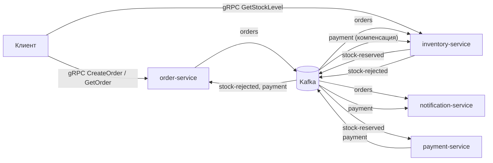
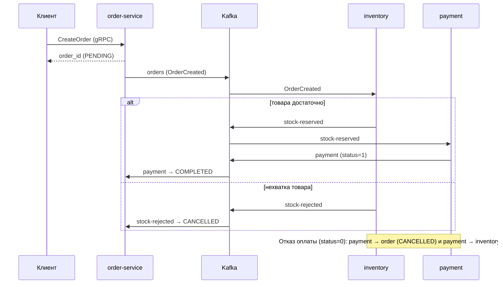
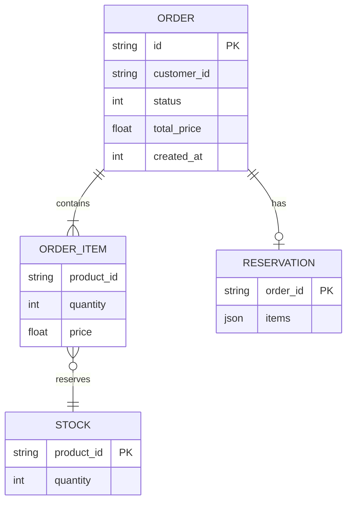
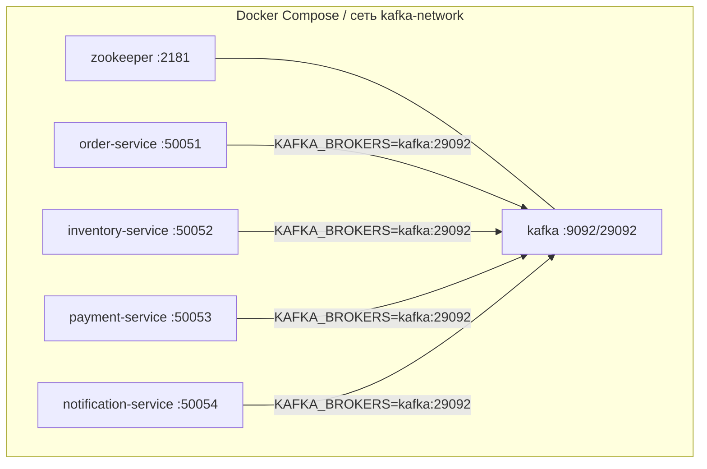

# Распределённая система обработки заказов (Event-Driven Architecture, Kafka, gRPC)

Прототип (MVP) к курсовой работе «Архитектура клиент-серверных приложений».
Тема: *Разработка и обоснование архитектуры распределённой системы обработки заказов на основе событийно-ориентированного подхода с использованием брокера сообщений Kafka и межсервисного взаимодействия по протоколу gRPC.*

## 1. Предметная область и требования

Интернет-магазин принимает заказы; для каждого нужно зарезервировать товар, провести оплату и уведомить клиента. Шаги выполняются разными сервисами, которые должны развиваться и масштабироваться независимо.

**Функциональные требования**
- FR1. Создание заказа и получение его статуса (gRPC, `OrderService`).
- FR2. Резервирование товаров на складе по принципу «всё или ничего».
- FR3. Оплата заказа после успешного резервирования.
- FR4. Отмена заказа и снятие резерва при отказе в оплате или нехватке товара (компенсация).
- FR5. Уведомление клиента о создании заказа и результате оплаты.
- FR6. Запрос остатка товара (gRPC, `InventoryService`).

**Нефункциональные требования**
- NFR1. Слабая связанность: сбой сервиса не блокирует приём заказов.
- NFR2. Горизонтальное масштабирование потребителей (consumer groups, партиции).
- NFR3. Идемпотентность обработчиков (доставка at-least-once).
- NFR4. Низкая задержка синхронных вызовов клиента (бинарный gRPC/Protobuf).
- NFR5. Воспроизводимое развёртывание (Docker Compose).

**Ограничения.** Разработчик один, стек — Go; ресурсы — одна машина; нагрузка в прототипе — десятки заказов/с; хранилища in-memory (см. «Ограничения прототипа»).

**Этапы и сроки (ориентир).** Анализ и требования — 1 нед.; выбор архитектуры и диаграммы — 1 нед.; реализация сервисов и саги — 3 нед.; тестирование и развёртывание — 1 нед.; оформление отчёта — 2 нед.

## 2. Выбор архитектурного стиля

Оценка по 5-балльной шкале (5 — лучше). Добавлен проектный критерий «отказоустойчивость».

| Стиль | Масштабируемость | Производительность | Простота разработки | Совместимость со стеком (Go, Kafka, gRPC) | Отказоустойчивость | Итого |
|---|---|---|---|---|---|---|
| Монолит | 2 | 4 | 5 | 3 | 1 | 15 |
| Многоуровневая (N-tier) | 2 | 3 | 4 | 3 | 2 | 14 |
| Микросервисы + синхронный REST/gRPC | 4 | 3 | 3 | 4 | 2 | 16 |
| SOA (ESB) | 3 | 2 | 2 | 2 | 3 | 12 |
| **Микросервисы + Event-Driven (Kafka) + gRPC на границе** | **5** | **4** | **3** | **5** | **5** | **22** |

**Обоснование.** Событийная модель развязывает сервисы по времени: заказ принимается, даже если склад или оплата временно недоступны, а события сохраняются в журнале Kafka и обрабатываются позже. Потребители масштабируются через consumer groups. gRPC выбран для синхронного клиентского API (строгий контракт, Protobuf, малая задержка), Kafka — для асинхронного обмена между сервисами.

**Компромиссы.** Выигрыш в отказоустойчивости и масштабируемости оплачивается eventual consistency (статус заказа сходится не мгновенно), сложностью отладки и необходимостью идемпотентности и компенсаций.

## 3. Архитектура

### 3.1 Компоненты и взаимодействие



### 3.2 Сага (хореография): основной сценарий и компенсации



Оплата запускается только после резервирования, поэтому возвратов средств не требуется: компенсация нужна лишь для склада.

### 3.3 Контракты

**gRPC** (`proto/order.proto`, `proto/inventory.proto`):

| Сервис | Метод | Запрос → ответ |
|---|---|---|
| OrderService | CreateOrder | `customer_id, items[]` → `order_id` |
| OrderService | GetOrder | `order_id` → `Order{status: PENDING/PROCESSING/COMPLETED/CANCELLED}` |
| InventoryService | GetStockLevel | `product_id` → `stock_quantity` |

**События Kafka (JSON, ключ = `order_id`, что гарантирует порядок событий одного заказа в партиции):**

| Топик | Производитель | Потребители (consumer group) | Поля |
|---|---|---|---|
| `orders` | order | inventory, notification | `id, customer_id, items[], total_price, status, created_at` |
| `stock-reserved` | inventory | payment | `id, customer_id, total_price` |
| `stock-rejected` | inventory | order | `id, customer_id, total_price, reason` |
| `payment` | payment | order, inventory, notification | `order_id, status (0/1), amount` |

### 3.4 Модель данных (in-memory в прототипе)



### 3.5 Физическая инфраструктура



CI/CD в проекте не настроен; рекомендуемый минимум — GitHub Actions: `go vet`, `go test ./...`, сборка образов из `docker/`.

## 4. Применённые паттерны

| Паттерн | Где применён |
|---|---|
| Event-Driven / Pub-Sub | обмен между сервисами через топики Kafka |
| Saga (choreography) + компенсирующая транзакция | `stock-reserved → payment`, снятие резерва в `inventory.HandlePayment` |
| Idempotent Consumer | `processed`/`paymentEvents`/статусы финальны в `order.setStatus` |
| Database per service | у каждого сервиса собственное состояние |
| Retry + poison message | `pkg/kafka/consumer.go` (3 попытки, затем пропуск; в production — DLT) |
| Ports & Adapters | интерфейсы `eventPublisher`, `PaymentGateway` позволяют подменять инфраструктуру в тестах |
| CQRS (применимо) | запись — события, чтение — `GetOrder`/`GetStockLevel`; полноценное разделение — направление развития |
| DDD | границы сервисов совпадают с ограниченными контекстами: Orders, Inventory, Payment, Notification |

MVC/MVVM неприменимы: у системы нет пользовательского интерфейса.

## 5. Обоснование технологий

| Технология | Зачем |
|---|---|
| Go | лёгкие горутины, быстрые статические бинарники, зрелая экосистема gRPC/Kafka |
| Kafka (`segmentio/kafka-go`) | долговечный журнал, партиционирование по ключу, consumer groups, повторное чтение |
| gRPC + Protobuf | строгий контракт, кодогенерация, бинарный формат |
| Docker / Compose | воспроизводимое окружение; для продакшена — Kubernetes |
| zap / slog | структурированное логирование |

## 6. Запуск и проверка

```bash
docker compose up --build
go test ./...
```

Создание заказа (нужен `grpcurl`, рефлексия не включена — используйте proto-файл):

```bash
grpcurl -plaintext -import-path proto -proto order.proto \
  -d '{"customer_id":"c1","items":[{"product_id":"soup","quantity":2,"price":50}]}' \
  localhost:50051 order.OrderService/CreateOrder
grpcurl -plaintext -import-path proto -proto order.proto \
  -d '{"order_id":"<id>"}' localhost:50051 order.OrderService/GetOrder
```

Сценарии: сумма ≤ 200 — заказ `COMPLETED`; сумма > 200 — оплата отклонена, заказ `CANCELLED`, резерв снят; товара нет на складе (`soup`: 10, `bread`: 25) — `CANCELLED`.

## Ограничения прототипа и дальнейшее развитие

- Состояние хранится в памяти: после перезапуска теряется. Следующий шаг — PostgreSQL и **Transactional Outbox**, чтобы запись заказа и публикация события были атомарны (сейчас при сбое публикации заказ остаётся без события).
- JSON вместо Protobuf/Schema Registry для событий; нет версионирования схем.
- Одна партиция и один брокер (replication factor 1); топики, кроме `orders`, создаются автоматически брокером.
- Нет Dead Letter Topic, метрик (Prometheus), трассировки (OpenTelemetry), аутентификации gRPC (TLS/JWT).
- `notification-service` пока только логирует уведомления.
